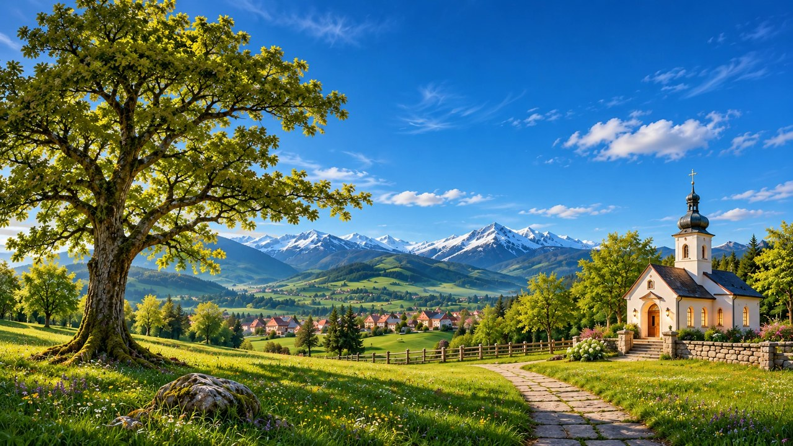

# HA Seasons Universal V1.6.1 – celoplošný šetrič Home Assistanta

**HA Seasons Universal** is an adaptive, full-screen Home Assistant dashboard screensaver with seasonal scenery, live weather, rain and snow effects, and a visual card editor. It works with or without a local weather station and adapts automatically to landscape or portrait tablet layouts.

<!-- ha-marketplace:exclude-start -->
[](https://my.home-assistant.io/redirect/marketplace_repository/?owner=vavro0321-max&repository=ha-seasons-universal&category=plugin)

**Quick install:** Open the Marketplace badge above, add this public repository as a custom **Dashboard** repository and install it. Until this project is accepted into the public Marketplace catalog, search results will not include it automatically.
<!-- ha-marketplace:exclude-end -->

Samostatný šetrič obrazovky pre ľubovoľný Lovelace dashboard. **Nemení jeho vzhľad, rozloženie, karty ani ovládanie.** Po 30 sekundách nečinnosti sa zobrazí celoplošná sezónna krajina. Jeden dotyk obnoví pôvodný dashboard (prvý dotyk nič v domácnosti nezapne).



## Nové vo V1.6.1 – viditeľnejšia, ale stále nočná krajina

- V noci sú kostolík, dedina, cesta a hory lepšie viditeľné. Modrastá nočná atmosféra zostáva zachovaná.
- Jasná noc pri splne je svetlejšia než polooblačná alebo zamračená noc.
- Silné tmavé filtre boli zmiernené a prechod súmrak → noc → svitanie je plynulý.
- **Denný jas sa nemení**, naďalej závisí od výšky Slnka a (ak je dostupná) meteostanice WS2900.
- V grafickom editore karty pribudol posuvník **Jas nočnej krajiny**. Predvolená hodnota je **110 %**, prípustný rozsah je **80–135 %**. Hodnota je násobiteľ nočného osvetlenia, nie fyzického jasu displeja.

```yaml
type: custom:ha-seasons-universal-card
idle_seconds: 30
source: auto
night_brightness: 1.1  # predvolené; pre jasnejšiu noc skúste 1.2 alebo 1.25
```

Na existujúcom dashboarde sa nová predvolená hodnota zapne automaticky bez úpravy YAML. Po aktualizácii modulu obnov stránku na tablete.

## Nové vo V1.6 – štyri schválené fotografie + dynamické počasie

Používame štvoricu používateľom schválených pohľadov na rovnakú dedinu s kostolíkom vľavo. Každý záber je uložený samostatne vo veľkosti **1536 × 864**: `universal-landscape-spring.webp`, `universal-landscape-summer.webp`, `universal-landscape-autumn.webp`, `universal-landscape-winter.webp`. Piaty, odvodený `universal-landscape-winter-dry.webp`, slúži pre **zimu bez snehu** pri teplom suchom počasí. Pôvodné súbory zostávajú ako záloha.

- **Jar:** strom kvitne počas celej jari. **Leto:** zelený strom. **Jeseň:** holé vetvy. **Zima:** bez lístia, zasnežená alebo suchá podľa podmienok.
- **Slnko:** vypočítané podľa `sun.sun` a jeho výšky; teplé svitanie a západ, plynulé zosvetľovanie/stmievanie. Poloha grafického slnka v panoráme je ilustračná.
- **Počasie:** jasná, polooblačná a zamračená obloha, statické oblaky, hmla podľa `weather.fog` alebo vlhkosti/rosného bodu, dážď podľa intenzity a hlásené sneženie.
- **Mesiac a noc:** mesačný svit podľa fázy a oblačnosti, hviezdy pri jasnej noci a postupne rozsvietené okná kostola/dediny.
- **Sneh a námraza:** orientačný vzhľad podľa vonkajšej teploty a hláseného sneženia, bez tvrdenia, že ide o meranú vrstvu.
- **Kamery:** šetrič sa pri otvorenom `#kamery` nespustí; po návrate sa 30 sekúnd odpočítava odznova.

Nastavenie `unified_scene: true` sa ponecháva. **Nezapínať znovu starý šetrič** z karty `ha-seasons-background`. Po Marketplace aktualizácii obnov cache stránky na tablete.

Ukážka YAML:

```yaml
type: custom:ha-seasons-universal-card
idle_seconds: 30
source: auto
scene: auto
phase: auto
unified_scene: true
image_fit: cover
fog_effect: true
snow_cover: true
moonlight_effect: true
night_lights: true
pause_on_camera: true
```

**Poznámka:** sezónne fotografie sú podobne komponované, ale nie pixelovo totožné; pri zmene ročného obdobia sa môže mierne posunúť poloha detailov. Počas jedného dňa sa však fotografia nemení podľa svetla, mení sa len nasvietenie a počasie.

## Nové vo V1.3 – živá nočná krajina a sneh

- Jasná, polooblačná a zamračená noc majú odlišné osvetlenie a oblohu.
- Fáza Mesiaca a oblačnosť ovplyvňujú mesačné svetlo: pri splne a jasnej noci je krajina svetlejšia. Bez senzora Mesiaca sa fáza odhaduje.
- Okná domov a kostolíka sa po zotmení jemne rozsvietia, bez prepínania alebo zdvojenia fotografie.
- Plynulá simulovaná námraza/snehová pokrývka sa mení podľa vonkajšej teploty. **Nie je to meranie skutočnej snehovej pokrývky**; na to treba samostatný senzor alebo spoľahlivé údaje o stave snehu.
- Padajúci sneh sa zobrazí len pri hlásenom snežení; mráz sám nespúšťa sneženie.
- V grafickom editore sú tri nové prepínače: svetlá v dedine, mesačné osvetlenie a snehová pokrývka.

Nové prepínače majú v existujúcich kartách predvolenú hodnotu **zapnuté**, takže **YAML nemusíš meniť**. Aktualizuj doplnok cez Marketplace/HACS a obnov cache stránky na tablete.

## Nové vo V1.2 – plynulý deň, noc a svitanie

- Od rána do večera sa osvetlenie mení **plynulo podľa výšky slnka** zo senzora `sun.sun`.
- Približne pred západom sa krajina stlmí a dostane jemné teplé farby.
- Po západe postupne tmavne, **najtmavšia je hlboká noc**, pred východom postupne svitá.
- Hviezdy a Mesiac sa prirodzene zjavujú a miznú podľa polohy slnka a oblačnosti.
- WS2900 stále koriguje denný jas, ale v noci ho slnečné žiarenie nerozjasňuje.
- **V každom okamihu je len jedna krajina**, takže stromy a domy pri prechode medzi dňom a nocou nepreskakujú.
- Ak v Home Assistante chýba výška slnka, používa sa len orientačný časový odhad.

Bežná konfigurácia sa **nemení**, stačí aktualizovať doplnok v Marketplace/HACS a obnoviť stránku (prípadne vymazať cache prehliadača).

## Predchádzajúce vydanie V1.5

Pôvodné dve fotografie `universal-landscape.webp` a `universal-landscape-leafless.webp` zostávajú v repozitári ako historické a záložné podklady. V1.6 používa päť nových samostatných sezónnych fotografií vyššie; pri zmene ročného obdobia sa prepne fotografia, nie poloha žiadnych Home Assistant ovládacích prvkov.

## Nové vo V1.5 – jedna spoločná krajina podľa dodanej fotografie

Pôvodnú fotografiu s kostolíkom **naľavo**, dedinou, cestou a horami používame ako spoločné pozadie. Zdrojová fotografia `dist/assets/universal-landscape.webp` je pre jar, leto a skorú jeseň; pixelovo podobná odvodená verzia `dist/assets/universal-landscape-leafless.webp` odstráni lístie od 10. novembra a v zime. Poloha kostolíka, hôr a domov zostáva zachovaná.

Doplnok ďalej používa plynulý deň/noc, mesačný svit, oblačnosť, teplotne odhadovanú námrazu a sneh, nočné svetlá a pozastavenie šetriča na `#kamery`. Teraz pribudla:
- statická hmla podľa `weather.fog`; voliteľne orientačný výpočet z vysokej vonkajšej vlhkosti, rosného bodu a slabého vetra
- suchšia hnedá neskoro-jesenná tráva a zimná vegetácia
- letné/jarné/jesenné farby z tej istej fotografie

**Oba obrázky sú už nahrané** priamo na GitHub a po preinštalovaní cez Marketplace sa použije nové spoločné pozadie. Ak sa po aktualizácii stále ukazuje staré pozadie, obnov stránku tabletu a jej vyrovnávaciu pamäť.

Nastavenia v YAML (všetko je už štandardne zapnuté):

```yaml
type: custom:ha-seasons-universal-card
idle_seconds: 30
source: auto
scene: auto
unified_scene: true
fog_effect: true
season_colors: true
night_lights: true
moonlight_effect: true
snow_cover: true
pause_on_camera: true
entities:
  weather: weather.forecast_cierne_11
  temperature: sensor.ws2900_v2_02_01_outdoor_temperature
  humidity: sensor.ws2900_v2_02_01_humidity
  dewpoint: sensor.ws2900_v2_02_01_dewpoint
```

Poznámka: hmla a snehová vrstva založené na senzoroch sú vizuálne odhady, nie fyzické meranie hmly či výšky snehu.

## Nové vo V1.4 – ročné obdobia majú odlišnú krajinu

Pri kontrole pôvodných podkladov sme našli chybu: fotografické obrázky pre **jar, leto a jeseň** mali takmer rovnaké zelené lístie, takže aj v novembri vyzerala dedina letne. Dátumový výber jesene fungoval, ale grafika nebola dostatočne jesenná.

Oprava používa selektívnu úpravu farebnosti rastlín priamo v prehliadači, aby zostali zachované pôvodné hory, kostolík, cesta aj obloha. Pozadie sa pri prechode deň–noc stále nemení na inú fotografiu.

- **Jar:** svieža svetlejšia zeleň a jemné kvety na strome.
- **Leto:** sýta zelená tráva a listy.
- **Jeseň:** počas septembra sa postupne objavuje zlaté lístie, v októbri a novembri prevládajú žlté, oranžové a hnedé odtiene aj na tráve.
- **Zima:** holý strom aj bez snehu; pri teplom suchom počasí je zem bez snehového efektu. Pri mraze sa môže zobraziť ilustračná námraza a pri hlásenom snežení padajúci sneh. Skutočnú snehovú pokrývku program nemeria.

Nová voľba v grafickom editore **„Výrazné farby ročných období (jar, leto, jeseň)”** je zapnutá predvolene. Pri potrebe vypnutia použi `season_colors: false`. Pri prepínaní počiatočnej fotografie sa môže úprava farieb načítať s krátkym oneskorením (najmä na slabšom tablete), no pôvodný obrázok zostáva viditeľný.

```yaml
type: custom:ha-seasons-universal-card
idle_seconds: 30
source: auto
scene: auto
season_colors: true
```

Dňa **21. novembra 2026** musí `scene: auto` zvoliť **autumn**, bez ohľadu na to, či je deň alebo noc. Je to vizuálna sezónna úprava; skutočnú farbu lístia v okolí domu nemeriame.

## Nové vo V1.3.1 – Kamery bez šetriča

Pri otvorenom pop-upe `#kamery` alebo pohľade `/lovelace/kamery` sa celoplošný šetrič **automaticky pozastaví**. Po návrate na Domov alebo iný pohľad začne nových 30 sekúnd nečinnosti. Kamera sa tým nevypína ani neprerušuje.

Nastavenie je **predvolene zapnuté** a je prístupné aj v grafickom editore karty. V YAML môžeš použiť:

```yaml
type: custom:ha-seasons-universal-card
idle_seconds: 30
pause_on_camera: true
```

Ak by si ho niekedy chcel vypnúť, nastav `pause_on_camera: false`. Táto funkcia rozpoznáva hash `#kamery`, `#kamera`, `#camera`, `#cameras` a rovnako pomenované Lovelace pohľady.

## Funkcie
- Dátum, čas, vonkajšia teplota, kúrenie, meniny a počty zapnutých svetiel
- Jar, leto, jeseň, zima; Veľká noc, máj, Dušičky, Mikuláš, Vianoce, Nový rok
- Deň, svitanie, západ slnka, noc; Mesiac podľa senzora, inak označený približný výpočet
- Jasno, polooblačno, zamračené; dážď a sneh s pokojnou animáciou
- Dva zdroje počasia: lokálna meteostanica alebo entita `weather.*` z internetovej služby
- **Jedna fotografia v jednej chvíli** (žiadne prekrývanie dvoch krajín)
- Pri automatickej detekcii sa použijú dostupné entity; chýbajúce informácie sa zobrazia ako `—`

## Grafický editor v Home Assistante (nové vo V1.1)

Po inštalácii otvor **Upraviť dashboard → Pridať kartu → HA Seasons Universal**, potom prejdi do **grafického editora karty**. Nastavíš bez YAML:

- spustenie po 5–3600 sekundách;
- rozloženie **Automaticky / Kompaktné / Široké**;
- sklenený alebo minimalistický štýl, veľkosť hodín, priehľadnosť a posun/orez obrázka;
- zdroj počasia **automaticky / meteostanica / online**;
- automatické či manuálne ročné obdobie a čas dňa;
- zapnutie/vypnutie jednotlivých informačných polí a animácií;
- konkrétne entity počasia, senzorov, kúrenia a svetiel.

Grafika sa automaticky preusporiada podľa orientácie tabletu **na šírku aj na výšku**, s menšími prvkami na nízkych a úzkych displejoch. Používa jediný obrázok krajiny; na tablete môžu byť krajné časti pri pomere strán `cover` orezané, ale nie zdvojené.

### Pridanie do akéhokoľvek dashboardu

Do dashboardu vlož **jednu manuálnu kartu** (môže byť na konci ľubovoľného zobrazenia):

```yaml
type: custom:ha-seasons-universal-card
idle_seconds: 30
source: auto
```

Šetrič neprepisuje existujúci `background:`. Karta má len 1 px výšky a ovláda celoplošné zobrazenie. Je aktívna len na pohľade dashboardu, ktorý kartu obsahuje.

### Pre druhý HA bez meteostanice

```yaml
type: custom:ha-seasons-universal-card
idle_seconds: 30
source: online
entities:
  weather: weather.forecast_home
```

Vymeniť `weather.forecast_home` za skutočnú entitu zo svojho Home Assistanta. Pri `source: auto` si vyhľadá dostupnú entitu `weather.*` a, ak existujú, aj lokálne senzory. `source: online` miestne senzory ignoruje.

### Voliteľná presná konfigurácia

```yaml
type: custom:ha-seasons-universal-card
idle_seconds: 30
source: station
entities:
  weather: weather.forecast_cierne_11
  temperature: sensor.ws2900_v2_02_01_outdoor_temperature
  rain: sensor.ws2900_v2_02_01_rain_rate
  solar: sensor.ws2900_v2_02_01_solar_radiation
  wind: sensor.ws2900_v2_02_01_wind_speed
  gust: sensor.ws2900_v2_02_01_wind_gust
  heating: switch.thermostat_switch
  nameday: sensor.meniny_dnes
  moon: sensor.moon_faza
  lights:
    - light.led_spodok_kuchyna
    - switch.stromcek
```

## Inštalácia

**Home Assistant Marketplace (2026.11+) / HACS:** Repo musí byť zverejnené vo vlastnom **verejnom GitHub repozitári**, napríklad `ha-seasons-universal`. V HA otvor **Nastavenia → Marketplace → Add from link**, zadaj jeho URL, nainštaluj Dashboard a vlož kartu cez grafické rozhranie. Po inštalácii Marketplace automaticky načíta modul z `/local/community/ha-seasons-universal/ha-seasons-universal.js`. Na starších verziách HA použite HACS → Custom repositories → Dashboard. **ZIP nie je zverejnený repozitár**.

**Ručná inštalácia:** Skopíruj obsah `dist/` do `/config/www/ha-seasons-universal/`, pridaj Dashboard zdroj typu JavaScript Module `/local/ha-seasons-universal/ha-seasons-universal.js?v=1.6.0`, obnov stránku a pridaj manuálnu kartu.

Test bez senzorov: `/local/ha-seasons-universal/TEST.html` (pri ručnej inštalácii). Test používa simulované hodnoty a nemení žiadnu entitu.

## Poznámky

- Zrážkový senzor WS2900 vie zaznamenať dážď, nie padajúci sneh. Sneženie bez samostatného senzora je iba odhad podľa entity počasia.
- Bez stanice intenzita dažďa nie je miestne meranie; ide o orientačný efekt podľa `weather.*`.
- Šetrič nedokáže rozsvietiť vypnutú fyzickú obrazovku tabletu.
- Fotografie niektorých špeciálnych sviatočných scén sú zatiaľ staršie kreslené SVG. Na ich spracovanie sa používa **jediný** obraz, nie skladanie dvoch panorám.
- V prípade akýchkoľvek problémov stačí odstrániť túto jednu kartu a JS resource; pôvodný dashboard zostáva bez zmeny.

## Technické poznámky

- Jedna karta na jeden Lovelace pohľad je odporúčaný spôsob použitia. Šetrič nevytvára globálnu automatizáciu na všetkých dashboardoch.
- Grafický editor volá štandardné `getConfigElement()` a `config-changed`; konfigurácia sa ukladá do dashboardu.
- Jediné externé údaje číta z existujúcich entít Home Assistanta; modul sám nevyžaduje ani neodosiela údaje na vlastný server.
- Na zariadeniach s redukovanými animáciami systém vypne pohyb lístia.
- Ak sa šetrič nespúšťa, skontroluj režim úprav dashboardu, aktívny pohľad, stav načítania JS a to, či obrazovka neprešla do fyzického režimu spánku.
